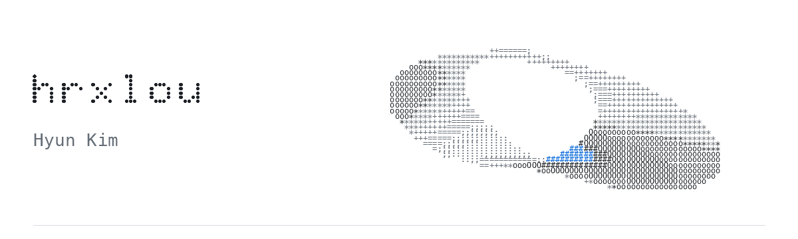

<picture>
  <source media="(max-width: 600px) and (prefers-reduced-motion: reduce) and (prefers-color-scheme: dark)" srcset="assets/header-ascii-mobile-dark.svg">
  <source media="(max-width: 600px) and (prefers-reduced-motion: reduce)" srcset="assets/header-ascii-mobile-light.svg">
  <source media="(prefers-reduced-motion: reduce) and (prefers-color-scheme: dark)" srcset="assets/header-ascii-dark.svg">
  <source media="(prefers-reduced-motion: reduce)" srcset="assets/header-ascii-light.svg">
  <source media="(max-width: 600px) and (prefers-color-scheme: dark)" srcset="assets/header-ascii-mobile-dark.gif">
  <source media="(max-width: 600px)" srcset="assets/header-ascii-mobile-light.gif">
  <source media="(prefers-color-scheme: dark)" srcset="assets/header-ascii-dark.gif">
  <source media="(prefers-color-scheme: light)" srcset="assets/header-ascii-light.gif">
  
</picture>

### About

한성대학교 컴퓨터공학부 3학년입니다. 웹과 앱을 만들며, 풀스택 개발자를 목표로 공부하고 있습니다.

- **공부 중** · UI/UX Design, Cloud Computing
- **수상** · 한성공학경진대회 동상
- **기록** · [개발 기록](https://hrxlou.com/log)과 [사진·영상 작업](https://hrxlou.com/gallery)을 개인 사이트에 모읍니다.

### Selected projects

| Project | Work |
| :--- | :--- |
| [CodexHub](https://github.com/hrxlou/CodexHub) | Codex 계정과 사용량을 관리하는 macOS 앱 · 앱 개발, SwiftUI 구현 |
| [Routee](https://github.com/Routex-labs/Routee) | 실내·외 통합 경로 안내 앱 · UI/UX 설계, 센서 데이터 분석·활용 |
| [OpenSimCity](https://github.com/hrxlou/OpenSimCity) | Unity·C#으로 개발 중인 2.5D 도시 시뮬레이션 게임 |

[hrxlou.com](https://hrxlou.com) &nbsp; / &nbsp; [Contact](mailto:hyunkim@hrxlou.com)
