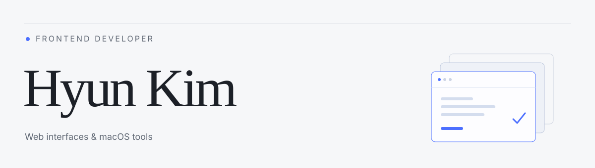

<picture>
  <source media="(prefers-color-scheme: dark)" srcset="assets/header-dark.svg">
  <source media="(prefers-color-scheme: light)" srcset="assets/header-light.svg">
  
</picture>

### 무엇이든 만들고, 고치면서 배웁니다.

React와 TypeScript로 웹을 만들고, SwiftUI로 macOS 도구를 만듭니다.

[Portfolio](https://hrxlou.com) · [Email](mailto:hyunkim@hrxlou.com)

### Selected work

| Project | About | Stack |
| :--- | :--- | :--- |
| [Portfolio](https://hrxlou.com) | 작업과 기록을 모은 개인 웹사이트 | React · TypeScript |
| [CodexHub](https://github.com/hrxlou/CodexHub) | Codex 계정과 사용량을 관리하는 macOS 메뉴 막대 앱 | Swift · SwiftUI |
| [Routee](https://github.com/Routex-labs/Routee) | 실외에서 실내까지 이어지는 경로 안내 데모 · 팀 프로젝트 | Flutter · Dart |
